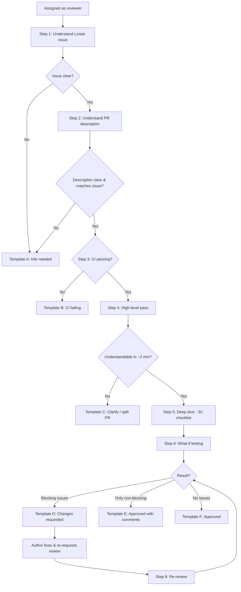

# 3C Code Review Guide

From **Linear issue** to **GitHub approval** — written for the **assigned reviewer**.

> When you approve a PR, you share ownership of that change. Review it as if you will be the one fixing it at midnight.

---

## 0. Overview



| Step | What you do | Exit if… |
|---|---|---|
| 1 | Understand the Linear issue | Issue unclear → Template A |
| 2 | Understand the PR description | Missing / mismatched → Template A |
| 3 | Check CI | Red → Template B |
| 4 | High-level pass (Clarity) | Not understandable in ~2 min → Template C |
| 5 | Deep dive (3C) | — |
| 6 | What-if testing | — |
| 7 | Decide & notify (GitHub + Chatwork) | Template D / E / F |
| 8 | Re-review after fixes | Back to Step 7 |

---

## 1. The 3C Framework

| C | Covers | Ask |
|---|---|---|
| **Correctness** | Functionality, Format, Security | Does it work? Is it safe? |
| **Clarity** | Readability, Structure | Can a human follow it? |
| **Complexity** | Maintainability, Performance | Will it scale and stay easy to change? |

- Security lives under **Correctness** — unsafe code is broken code.
- Performance lives under **Complexity** — inefficient code is harder to maintain and slower to run.

---

## 2. Reviewer Responsibility

As the assigned reviewer, you are responsible for:

- **Responding on time** — start the review within the team's agreed time (e.g. 1 business day). If you can't, say so (Template G).
- **Understanding before judging** — read the Linear issue and PR description first.
- **Testing, not just reading** — run the "what if?" checks in Section 6.
- **Being clear** — every comment says what, why, and how (Section 7).
- **Owning the approval** — if a bug from this PR reaches production, you help fix it.
- **Closing the loop** — notify the author on Chatwork with the right template.

---

## 3. Step 1 — Understand the Linear Issue

Open the Linear issue linked to the PR. Before touching code, confirm:

- [ ] **Goal** — what problem is being solved?
- [ ] **Acceptance criteria** — what does "done" look like?
- [ ] **Scope** — what is in, and what is explicitly out?
- [ ] **Affected areas** — frontend / backend / admin / mobile / DB?
- [ ] **Priority / deadline** — is this a hotfix or a normal change?

If any of these are unclear → **Template A**.

---

## 4. Step 2 — Understand the PR Description

A good PR description should include:

- [ ] Linear issue link (e.g. `SAM-123`)
- [ ] **What** changed
- [ ] **Why** it changed
- [ ] **How to test** (steps)
- [ ] Screenshots / video for UI changes
- [ ] Risks, migrations, env var changes, breaking changes
- [ ] Rollback plan (if risky)

Check: **does the diff match the description and the Linear issue?** Extra unrelated changes are a red flag.

If missing or mismatched → **Template A**.

---

## 5. Steps 3–5 — CI, High-level Pass, Deep Dive

### Step 3 — CI check
- Linter (ESLint / Ruff), type check, tests, build must be green.
- **Red CI = don't review yet** → **Template B**.

### Step 4 — High-level pass (Clarity)
- Read the whole diff top to bottom on GitHub.
- If you can't understand the change in ~2 minutes, or the PR is too large (rough guide: 400+ changed lines across many concerns) → **Template C**.

### Step 5 — Deep dive (3C checklist)

**Correctness & Security**
- [ ] Meets every acceptance criterion in the Linear issue
- [ ] Edge cases handled (see Section 6)
- [ ] Inputs validated (schema validation on API boundaries)
- [ ] Auth / permissions checked on every protected route
- [ ] No secrets, tokens, or personal data in code or logs
- [ ] Error handling: errors are caught, logged, and shown to the user sensibly

**Clarity**
- [ ] Names describe intent
- [ ] Nesting is reasonable; functions do one thing
- [ ] Follows existing project conventions (incl. comment language)
- [ ] No dead code, debug logs, or commented-out blocks

**Complexity & Performance**
- [ ] No simpler way to achieve the same result
- [ ] No query inside a loop (N+1)
- [ ] No unnecessary re-renders / heavy work in render
- [ ] No new dependency without a clear reason
- [ ] Easy to change later; no hard-coded values that belong in config

### Pulling the branch locally (when needed)

```bash
git fetch origin
git checkout <branch-name>
```

Then install, run, and test locally (Section 6).

---

## 6. Step 6 — "What If?" Testing

Don't only test the happy path. Pick the categories that apply to the change.

| Category | Ask "what if…" |
|---|---|
| **Happy path** | It's used exactly as the Linear issue describes? |
| **Boundary values** | Empty, `null`, `0`, negative, max length, very large numbers? |
| **Input format** | Full-width (全角) chars, emoji, spaces, special chars, wrong type? |
| **Invalid input** | Required field missing? Malformed JSON? Wrong date format? |
| **Backward compatibility** | Old mobile app versions still call this API? Existing DB records have the old shape? Other services depend on the old response? |
| **Data migration** | Migration runs on existing data? Can it be rolled back? |
| **Regression** | Related screens / endpoints still work? |
| **Permissions** | Different role? Another store's / tenant's data? Logged out? Expired token? |
| **Concurrency** | Double-click submit? Two users edit the same record? Request sent twice? |
| **Failure** | Network timeout? External API (POS, payment) down or slow? Partial failure? Retry creates duplicates? |
| **Date / time** | JST vs UTC? Midnight, month end, year end? |
| **Money / numbers** | Rounding? Tax calculation? Decimal precision? |
| **UI states** | Loading, empty, error, long text, mobile width? |
| **Environment** | New env var set in all environments? Works in Docker as well as locally? |
| **Rollback** | If we revert this PR, does anything break? |

Write down what you tested — you'll paste it into the Chatwork template.

---

## 7. Comments: Severity + Request / Reason / Resource

### Severity label (start every comment with one)

| Label | Meaning | Blocks merge? |
|---|---|---|
| `[must]` | Bug, security issue, or breaks acceptance criteria | ✅ Yes |
| `[should]` | Strongly recommended; discuss if you disagree | ⚠️ Usually |
| `[suggestion]` | Optional improvement | ❌ No |
| `[nit]` | Tiny style / wording point | ❌ No |
| `[question]` | Need to understand before deciding | Until answered |

### Formula

- **Request** — what needs to change
- **Reason** — why, tied to Correctness / Clarity / Complexity
- **Resource** — a snippet, doc link, or suggested fix

> **Example**
> `[must]` Please move this query outside the loop **[Request]**. Querying inside a loop creates an N+1 problem and will slow down as the number of orders grows **[Reason]**. Fetch all at once instead: `select(Order).where(Order.id.in_(order_ids))` **[Resource]**.

Tips:
- Comment on the code, not the person.
- Use GitHub's **suggestion** block for small fixes so the author can apply in one click.
- Say what's good, too — one line is enough.

---

## 8. Step 7 — Decide & Notify

### Decision table

| Situation | GitHub review status | Chatwork template |
|---|---|---|
| Linear issue / PR description unclear | `Comment` | **A** |
| CI failing | `Comment` | **B** |
| Too large / can't understand | `Comment` | **C** |
| Any `[must]` (or unresolved `[should]`) | `Request changes` | **D** |
| Only `[suggestion]` / `[nit]` | `Approve` | **E** |
| No comments | `Approve` | **F** |
| You can't review in time | — | **G** |
| Re-review: all fixed | `Approve` | **H** |
| Re-review: still issues | `Request changes` | **D** |

### Chatwork templates

Replace `{…}` with real values. `[To:{account_id}]` mentions the author.

---

#### Template A — Info needed (issue / PR description unclear)

```
[To:{account_id}] {name}さん
[info][title]【レビュー保留】情報が必要です｜{LINEAR-ID}[/title]PR: {PR URL}
Linear: {Linear URL}

レビュー前に以下を確認させてください。
・{question 1}
・{question 2}

回答いただき次第、レビューを始めます。[/info]
```

```
[To:{account_id}] {name}
[info][title][Review on hold] Need more info | {LINEAR-ID}[/title]PR: {PR URL}
Linear: {Linear URL}

Before I start, could you clarify:
- {question 1}
- {question 2}

I'll start reviewing as soon as I hear back.[/info]
```

---

#### Template B — CI failing

```
[To:{account_id}] {name}さん
[info][title]【レビュー保留】CIが失敗しています｜{LINEAR-ID}[/title]PR: {PR URL}

失敗しているチェック: {lint / test / build}
エラー概要: {short summary}

修正後、再度レビュー依頼をお願いします。[/info]
```

```
[To:{account_id}] {name}
[info][title][Review on hold] CI failing | {LINEAR-ID}[/title]PR: {PR URL}

Failing check: {lint / test / build}
Summary: {short summary}

Please re-request review once it's green.[/info]
```

---

#### Template C — Clarify or split PR

```
[To:{account_id}] {name}さん
[info][title]【レビュー保留】PRの確認・分割のお願い｜{LINEAR-ID}[/title]PR: {PR URL}

変更範囲が大きく、意図を正確に把握するのが難しい状態です。
以下のいずれかをお願いできますか？
・{e.g. PR説明に変更の流れを追記}
・{e.g. {A} と {B} でPRを分割}

必要であれば10分ほど口頭で説明いただけると助かります。[/info]
```

```
[To:{account_id}] {name}
[info][title][Review on hold] Please clarify or split | {LINEAR-ID}[/title]PR: {PR URL}

The change is large and I can't follow the intent confidently yet.
Could you either:
- {e.g. add a walkthrough to the PR description}
- {e.g. split into {A} and {B}}

A quick 10-min walkthrough call also works.[/info]
```

---

#### Template D — Changes requested (blocking)

```
[To:{account_id}] {name}さん
[info][title]【修正依頼】{LINEAR-ID} {PR title}[/title]PR: {PR URL}

レビューしました。マージ前に以下の修正をお願いします。

[must]
・{issue 1} → {PR comment link}
・{issue 2} → {PR comment link}

[suggestion / nit]（任意）
・{optional point}

確認したテスト: {e.g. 正常系、境界値、権限、旧アプリ互換}

修正後、GitHubで再レビュー依頼をお願いします。[/info]
```

```
[To:{account_id}] {name}
[info][title][Changes requested] {LINEAR-ID} {PR title}[/title]PR: {PR URL}

Reviewed. Please fix the following before merge.

[must]
- {issue 1} → {PR comment link}
- {issue 2} → {PR comment link}

[suggestion / nit] (optional)
- {optional point}

Tested: {e.g. happy path, boundaries, permissions, old app compatibility}

Please re-request review on GitHub after fixing.[/info]
```

---

#### Template E — Approved with non-blocking comments

```
[To:{account_id}] {name}さん
[info][title]【承認・コメントあり】{LINEAR-ID} {PR title}[/title]PR: {PR URL}

承認しました。マージして問題ありません。
任意のコメントをいくつか残しています（対応は判断にお任せします）。
・{suggestion 1}
・{nit 1}

確認したテスト: {tested items}[/info]
```

```
[To:{account_id}] {name}
[info][title][Approved with comments] {LINEAR-ID} {PR title}[/title]PR: {PR URL}

Approved — OK to merge.
I left a few optional comments (your call):
- {suggestion 1}
- {nit 1}

Tested: {tested items}[/info]
```

---

#### Template F — Approved (no comments)

```
[To:{account_id}] {name}さん
[info][title]【承認】{LINEAR-ID} {PR title}[/title]PR: {PR URL}

承認しました。マージお願いします。
確認したテスト: {tested items}

ありがとうございます！[/info]
```

```
[To:{account_id}] {name}
[info][title][Approved] {LINEAR-ID} {PR title}[/title]PR: {PR URL}

Approved — please go ahead and merge.
Tested: {tested items}

Thanks![/info]
```

---

#### Template G — Can't review in time

```
[To:{account_id}] {name}さん
[info][title]【レビュー遅延】{LINEAR-ID}[/title]PR: {PR URL}

申し訳ありません、{reason} のため、レビュー開始が {date/time} 頃になります。
急ぎの場合は、他のレビュアーへの変更をご検討ください。[/info]
```

```
[To:{account_id}] {name}
[info][title][Review delayed] {LINEAR-ID}[/title]PR: {PR URL}

Sorry — due to {reason}, I can start around {date/time}.
If it's urgent, please feel free to reassign to another reviewer.[/info]
```

---

#### Template H — Re-review: all fixed

```
[To:{account_id}] {name}さん
[info][title]【再レビュー完了・承認】{LINEAR-ID} {PR title}[/title]PR: {PR URL}

修正を確認しました。すべて解決済みのため承認します。
マージお願いします。ありがとうございました！[/info]
```

```
[To:{account_id}] {name}
[info][title][Re-review: approved] {LINEAR-ID} {PR title}[/title]PR: {PR URL}

Checked the fixes — everything is resolved. Approved.
Please go ahead and merge. Thanks![/info]
```

---

## 9. Step 8 — Re-review

When the author re-requests review:

1. Check CI is green again.
2. Review **only the new commits** first (GitHub: "Changes since your last review").
3. Confirm every `[must]` comment is fixed, then **resolve the thread** yourself.
4. Quickly re-run the "what if" checks that touched the changed code.
5. Decide again → Template **H** (all fixed) or **D** (still issues).

If you and the author disagree after two rounds of comments, move to a short call or ask a third teammate. Don't let threads drag on.

---

## 10. After Approval

- The **author** merges (after all required approvals and green CI).
- Confirm the Linear issue moved to **Done** (or move it manually).
- If the change is risky, check it after deploy (logs, error tracking, the feature itself).

### Linear status reference

| Event | Linear status |
|---|---|
| Work started / branch created | In Progress |
| PR opened, review requested | In Review |
| Changes requested | In Review (or In Progress, per team rule) |
| PR merged | Done |

Linear can move these automatically via its GitHub integration — confirm your team's workflow settings in Linear.

---

## 11. Linter / Formatter Reference

**Frontend (Next.js / TypeScript)**
```bash
npm install -D eslint prettier eslint-config-prettier
npx eslint . --fix
npx prettier --write .
```

**Backend (FastAPI / Python)**
```bash
pip install ruff
ruff check . --fix
ruff format .
```

Until these run in CI, run them locally during Step 3.

---

## 12. Quick Checklist (copy this)

**Understand**
- [ ] Linear issue: goal, acceptance criteria, scope clear
- [ ] PR description: what, why, how to test, risks
- [ ] Diff matches issue and description

**Check**
- [ ] CI green
- [ ] Understandable in ~2 min

**3C**
- [ ] Correctness: works, edge cases, validation, auth, no secrets
- [ ] Clarity: readable, conventional, no dead code
- [ ] Complexity: simple, no N+1, no needless deps

**What if**
- [ ] Boundary / invalid input
- [ ] Backward compatibility (old app, old data, old clients)
- [ ] Permissions
- [ ] Concurrency / double submit
- [ ] Failure / external API down
- [ ] Date-time / money
- [ ] UI states
- [ ] Rollback

**Close the loop**
- [ ] Comments labeled and in Request / Reason / Resource format
- [ ] GitHub status set (Approve / Request changes / Comment)
- [ ] Chatwork template sent
- [ ] Re-review done, threads resolved
- [ ] Linear issue moved to Done after merge
